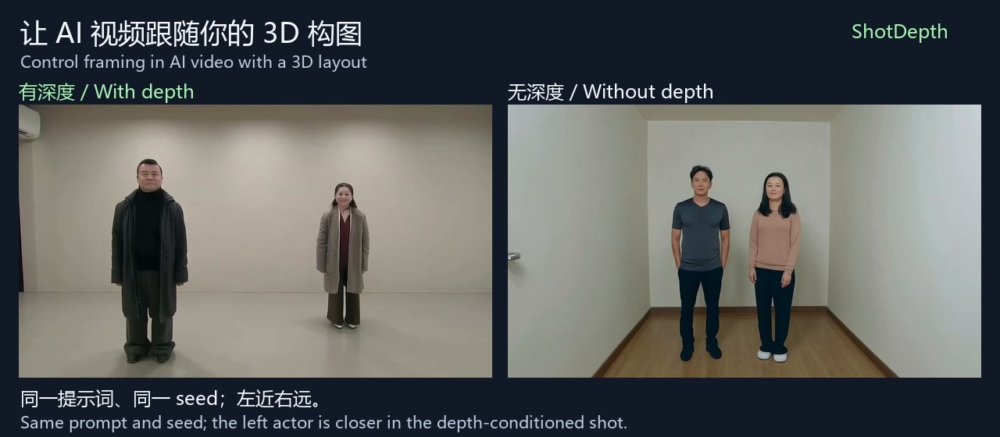
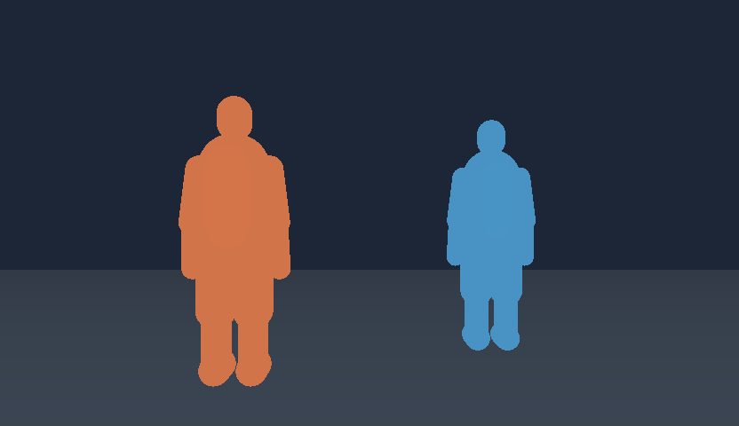
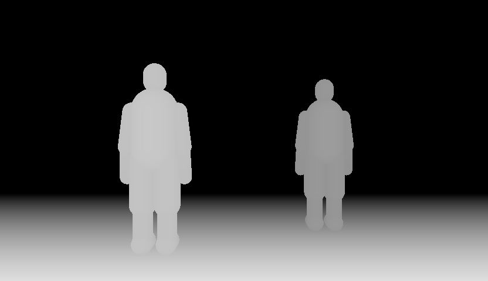
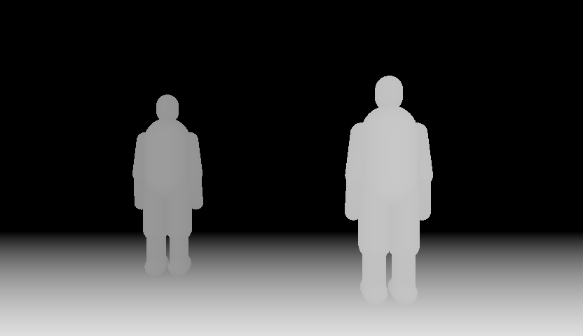
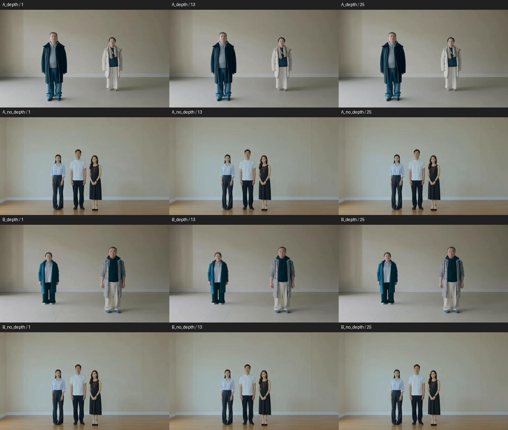
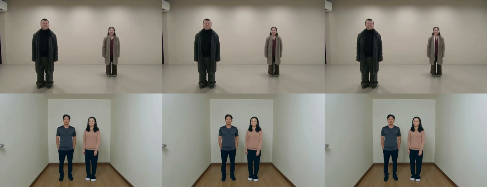

# ShotDepth — 3D shot layout and control export for AI video

在 3D 中摆好人物和机位，把**深度图、实例 ID 蒙版与相机几何**导出给视频工作流，也可直接导出 ComfyUI 所需的深度图片。<br>
Block actors and cameras in 3D, then export **depth maps, instance ID masks, and camera geometry** for video workflows, or export depth images directly for ComfyUI.

[](examples/demo/framing-demo.mp4)

[观看 16 秒双语字幕演示 / Watch the 16-second demo](examples/demo/framing-demo.mp4)

[不打开 App：通过 MCP 复现实例 / Reproduce via MCP without the app](#无界面复现--headless-reproduction)

ShotDepth 只负责摆位、预览和导出控制数据。不生成视频、不下载或附带模型权重，也不评价成片。<br>
ShotDepth handles blocking, previews, and control export. It does not generate or score video, nor download or bundle model weights.

原名 SpikeMark。旧仓库地址会跳转到 ShotDepth；MCP 标识和 v1.1 下载文件名保持不变。<br>
Formerly SpikeMark. The old repository URL redirects to ShotDepth; the MCP identifier and v1.1 download filenames are unchanged.

**v1.2.0 · Windows x64**：[GitHub Release](https://github.com/MlTt-Z/ShotDepth/releases/tag/v1.2.0) · [下载便携包 / Download portable ZIP](https://github.com/MlTt-Z/ShotDepth/releases/download/v1.2.0/ShotDepth-v1.2.0-win-x64.zip)

v1.2.0 可直接导出 ComfyUI 所需的 VACE 深度 PNG 和 Fun Control 动画 WebP，无需先导出控制 ZIP 再转换。<br>
v1.2.0 exports VACE depth PNGs and Fun Control animated WebP files directly for ComfyUI, without a control ZIP or a separate conversion step.

## 下游对照 / Downstream comparison

同一机位、同一提示词和 seed：A 中屏幕左侧人物更近，B 中右侧人物更近。无深度组不提供这一信息。案例检验**模型是否跟随人物的相对占画大小**，不检验动作、身份一致性或通用生成质量。

Same camera, prompt, and seed: the left actor is closer in A, the right actor in B. The no-depth runs receive neither layout. This checks relative on-screen size, not motion, identity, or general video quality.

| 镜头 / Shot | 3D 场景预览 / 3D scene preview | VACE 深度 / Depth |
| --- | --- | --- |
| A · 左近 / Left closer |  |  |
| B · 右近 / Right closer |  |  |

**判定标准 / Pass criteria**：在视频第 1、13、25 帧（从 1 开始计），两人均完整可见；A 中左人更高，B 中右人更高，且每帧较高者的像素身高至少是另一人的 1.10 倍。无深度组保留作对照，不要求它失败。单个 seed 不代表普遍有效。

**实测结果 / Results**：Wan2.1 VACE 1.3B 的四组视频均生成成功。人工检查第 1、13、25 帧：A 有深度组三帧均左人更高，B 有深度组三帧均右人更高；六帧均完整显示两人，较高者约为另一人的 1.3 倍，超过 1.10 的门槛。两组无深度视频在抽检帧中均出现三人。

All four Wan2.1 VACE 1.3B clips rendered successfully. On frames 1, 13, and 25, both depth-conditioned clips show two full-body actors. The left actor is taller in A and the right actor in B, at roughly 1.3× the other actor's on-screen height. Both no-depth clips show three people in all sampled frames. This is one seed and one setup, not a general benchmark.



成片 / Clips: [A 有深度 / Depth](examples/g0/A/depth.mp4) · [A 无深度 / No depth](examples/g0/A/no_depth.mp4) · [B 有深度 / Depth](examples/g0/B/depth.mp4) · [B 无深度 / No depth](examples/g0/B/no_depth.mp4)

<details>
<summary>复现步骤 / Reproduce</summary>

1. A 使用 [scene.json](scene.json)，B 应用 [摆位改动](examples/g0/shot-b-edits.json)。可用以下命令重新导出（输出目录不得已存在）：

```powershell
python shotdepth.py scene.json g0-a --vace-depth 2 7
python shotdepth.py scene.json g0-b --edits examples/g0/shot-b-edits.json --vace-depth 2 7
```

2. 启动 ComfyUI，准备 `wan2.1_vace_1.3B_fp16.safetensors`、`umt5_xxl_fp8_e4m3fn_scaled.safetensors`、`wan_2.1_vae.safetensors`，分别放入 `models/diffusion_models`、`models/text_encoders`、`models/vae`。把本页两张深度图放入 ComfyUI 输入目录的 `spikemark-g0/A/vace_depth.png` 和 `spikemark-g0/B/vace_depth.png`。
3. 运行 [queue.ps1](examples/g0/queue.ps1) 提交四个任务。它使用 [ComfyUI API 工作流](examples/g0/workflow_api.json)（不是用于拖入画布的 UI 工作流）。A/B 有深度组只更换输入图，无深度组只移除深度连接。均为 832×480、25 帧、24 fps、seed `20261127`。无深度的 A/B 输入相同；重复运行用于保持配对清晰，而不是两次独立试验。

```powershell
.\examples\g0\queue.ps1
```

</details>

## 无界面复现 / Headless reproduction

不打开桌面端或网页：用 MCP 摆位、检查预览并导出深度图，再通过本机 ComfyUI API 对比有／无深度的成片。示例脚本重放 AI 在这次试验中选定的坐标，不接受任意自然语言输入。

No desktop app or browser is needed: place actors, check the preview, and export depth via MCP, then queue a with/without-depth pair through the local ComfyUI API. The script replays the coordinates chosen by the AI for this test; it is not a general text-to-scene tool.

按上面的 G0 步骤准备模型并启动 ComfyUI，然后用已安装本项目依赖的 Python 运行 [复现脚本 / reproduction script](examples/headless/reproduce.py)。将路径替换为该实例实际使用的输入目录；若不是默认端口，追加 `--port 8189` 等参数。只导出控制图可追加 `--controls-only`。

Use the same models as G0 and start ComfyUI. Run the script with the project's Python dependencies installed, passing the actual ComfyUI input directory. Use `--port` for a non-default port or `--controls-only` to skip video jobs.

```powershell
.\.venv\Scripts\python.exe examples/headless/reproduce.py "X:\ComfyUI\input"
```

同提示词、同 seed（`20261128`），抽查第 1、13、25 帧：有深度时左侧人物明显更大，无深度时两人近似等高。这是一次构图遵从度对照，不代表画质提升。 / Same prompt and seed (`20261128`): in sampled frames 1, 13, and 25, the left actor appears clearly taller with depth and both are nearly equal in height without it. This tests framing adherence, not video quality.



## 快速开始 / Quick start

### Windows x64 便携版 / Portable app

1. 在 [v1.2.0 发布页 / release page](https://github.com/MlTt-Z/ShotDepth/releases/tag/v1.2.0) 的 Assets 中下载 `ShotDepth-v1.2.0-win-x64.zip`。 / Download `ShotDepth-v1.2.0-win-x64.zip` from Assets.
2. 解压整个 ZIP，打开解压后的文件夹并运行 `ShotDepth.exe`。 / Extract the entire ZIP, then run `ShotDepth.exe` from the extracted folder.
3. 包内已包含 Python，无需另装；桌面版需要 Microsoft Edge WebView2 Runtime，若系统未安装请先安装。 / Python is bundled. Install Microsoft Edge WebView2 Runtime if it is not already installed.

### 从源码运行 / Run from source

需要 Python 3.11 和现代浏览器。控制数据由 CPU 计算；交互式 3D 使用 WebGL，不可用时可使用表单和二维视图。Three.js 随项目提供，运行编辑器不依赖 CDN。

在项目根目录运行（Windows PowerShell）：

```powershell
py -3.11 -m venv .venv
.\.venv\Scripts\python.exe -m pip install -r requirements.txt
.\.venv\Scripts\python.exe editor.py --open
```

安装依赖后也可双击 `启动 ShotDepth.cmd`。默认地址为 `http://127.0.0.1:8766`，可用 `--port` 更改端口。服务仅用于本机，不要通过代理或端口转发公开它。

## 从构图到导出

1. 在沙盒中布置人物和道具，调整沙盒尺寸、体型、姿态和输出相机。观察沙盒的工作视角与输出机位相互独立。
2. 使用站立、走路、挥手预设，或在时间轴上编辑自己的关键帧。无法用几何表达的动作可写入 `shot.action_text`；它只传递给下游，不会改变预览或控制图。
3. 查看预览并提交草稿，再下载场景 JSON 或当前镜头的控制 ZIP。可导入、切换和下载由 1–12 个独立镜头组成的集合，ZIP 每次只导出当前镜头。编辑不会覆盖原始场景文件。
4. 将场景或控制包交给下游。外部 AI 也可以返回结构化编辑提案；在工作台中预览并选择应用或拒绝。

## 接入现有 ComfyUI 工作流（1.2）

在 v1.2.0 中，先应用场景草稿，再在导出区选择「导出 ComfyUI 深度」（简化模式也可用）。只导出当前镜头的已应用场景，无需解压控制 ZIP、运行转换脚本或安装自定义节点。把导出的图片放入 ComfyUI 的输入目录，在原工作流中接线即可：

| 导出格式 | 原生节点接线 | 对齐参数 |
| --- | --- | --- |
| VACE PNG（仅静态） | `Load Image` → `Repeat Image Batch` → `WanVaceToVideo.control_video` | 宽高与 PNG 一致，重复次数等于工作流帧数；在输出节点设置所需 FPS。 |
| Fun Control WebP（静态或动态） | `Load Image` → `WanFunControlToVideo.control_video`，绕过 Canny 或估深节点 | 宽高、帧数与 WebP 一致；在输出节点单独设置与导出一致的 FPS。 |

深度窗口默认用相机近远裁切面（近亮远暗），可为本次导出单独调整。WebP 宽高均须为 16 的倍数，帧数须为 5–117 内的 `4n+1`，宽 × 高 × 帧数不得超过 3200 万。静态 WebP 默认重复为 25 帧、24 fps，可调整；动态 WebP 保留源尺寸、帧数和帧率，不缩放、不补帧、不截断、不重采样。不符合限制时，先调整镜头分辨率或动态镜头时长／帧率并重新应用，再导出。

只需替换现有工作流的控制输入，不必更换整套工作流。VACE 与 Fun Control 的模型仍由用户分别配置；ShotDepth 不下载模型，也不启动生成。接线细节及原有 ZIP、CLI、Blender 路径见 [AI_INTEGRATION.md](AI_INTEGRATION.md)。

## 外部接口与输出

[外部 AI 调用契约](AI_INTEGRATION.md)包含 MCP（stdio）、本机 HTTP、批量镜头和提案的配置及示例。场景 JSON 是权威输入；坐标采用米、Y 轴向上，帧从 0 开始。

静态 ZIP 含清单、场景、几何、米制深度（`.npy`）、实例 ID 蒙版和预览。动态 ZIP 在 `frames/` 下提供逐帧深度、蒙版和几何；动态导出最多 120 帧、累计 3200 万像素。几何含相机内外参和投影框；深度为相机坐标系 Z 值，0 表示无效。可选 VACE 深度图采用固定近远范围（近处较亮）；成片效果取决于下游模型和工作流。

也可从命令行编译示例场景，输出目录必须尚不存在：

```powershell
.\.venv\Scripts\python.exe shotdepth.py scene.json output
```

## 许可

项目代码采用 [Apache License 2.0](LICENSE)；示例场景数据 `scene.json` 以 [CC0 1.0](https://creativecommons.org/publicdomain/zero/1.0/) 提供。随附的 Three.js 保留其 [MIT 许可声明](vendor/LICENSE)。
